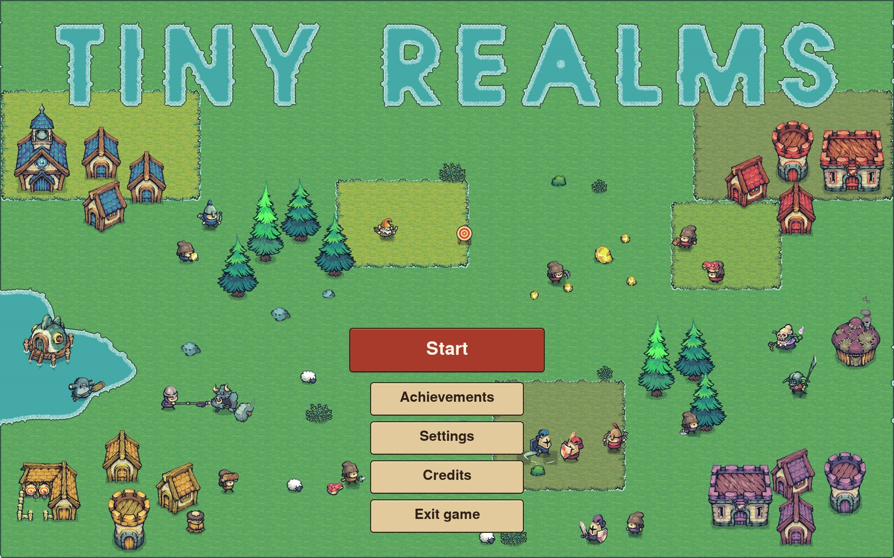
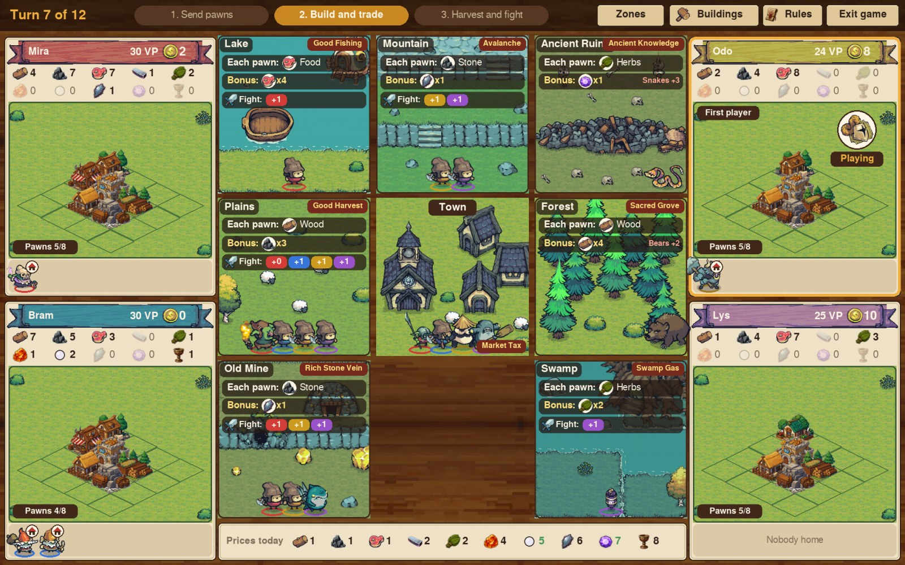
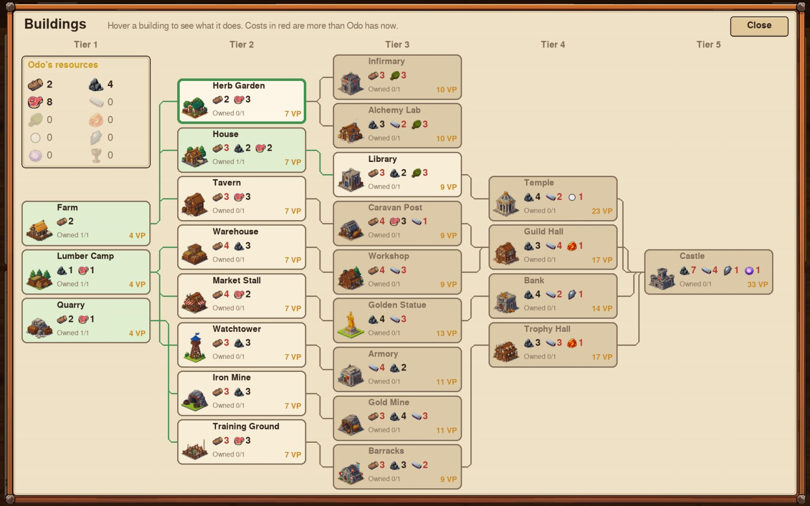
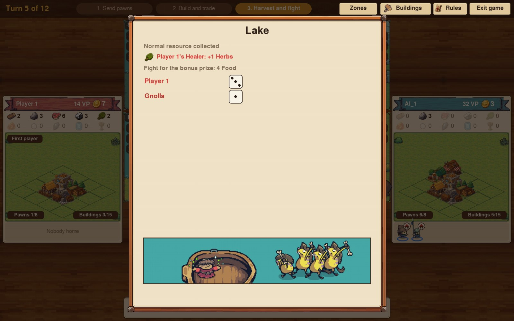

# Tiny Realms

**A tiny world full of big choices!** A strategy board game for 1 to 4 players, by AmauryBioCode,
made with Python and pygame-ce. Challenge clever computer opponents, play with friends on the same
screen, or mix both.

- **Get the full game** (play in your browser, or download for Mac and Windows):https://amaurybiocode.itch.io/tiny-realms
- **Try the demo in your browser:** https://amaurybiocode.itch.io/tiny-realms-demo

## The game

Gather resources, build your town, recruit new pawns, and fight monsters for treasure. Every turn
brings new choices, and every choice matters! The player with the most victory points at the end wins.

### What's in the Game?
- A tutorial, and the normal game for 1 to 4 players
- An advanced mode: factions, zone events, special monster abilities and challenges
- Two computer opponents: the Standard AI and the Advanced AI
- 29 achievements
- Colorblind help

## What is in this repository

The game's code, its tests and the trained computer players. **The art, music and sounds are not
included**: they come from asset packs whose licences don't allow sharing the files (see `CREDITS.txt`
for each pack and its link). To run the game from this code, get the packs and put them in an
`assets` folder; otherwise, play it on itch.io.

## Folders

- `main.py`: starts the game.
- `game/`: the game's code.
  - `data.py`: resources, zones, mobs, pawns and buildings. Change numbers here to rebalance.
  - `engine.py`: the rules.
  - `ai.py`: the Standard and Advanced computer players.
  - `app.py`: the window and every screen.
  - `art.py`, `screen.py`: the drawings, and a sharp picture on any screen.
  - `sound.py`, `settings.py`: the sound effects, and the saved settings (volumes, music, colorblind help).
  - `tutorial.py`, `achievements.py`: the tutorial with Sir Pebble and the achievements.
- `trained_ai/`: the trained computer players, one for each kind of game.
- `training/`: how the computer players are trained (see below).
- `tests/`: checks for the rules. Run them with `python3 -m pytest tests`.
- `packaging/`: the recipes to build the browser version, the Mac app and the Windows program.
- `screenshots/`: the pictures in this page.

## Run it from the code

With the `assets` folder in place:

    python3 -m pip install pygame-ce
    python3 main.py

On a Mac, you can also double-click `play.command`.

**Controls:** click a pawn at home, then a zone. Hover anything to read what it does. R opens the
rules, Esc closes a window, M turns the sound off or on.

## Build it

- Browser version (itch.io): `python3 packaging/build_web.py`. It makes `dist/TinyRealms-web.zip`;
  add `--test` to play it at http://localhost:8000 first.
- Mac app or Windows program: `python3 -m pip install pyinstaller pillow`, then
  `pyinstaller packaging/tiny_realms.spec`. The result is in the `dist` folder.

## The computer players

The **Standard AI** follows numbers learned by playing thousands of games against itself: one set for
each kind of game (8 or 12 turns, 2 to 4 players, with or without events). The **Advanced AI** uses the
same numbers, but before each move it tries every possible move on a few possible futures and keeps
the one worth the most victory points.

- `training/train_long.py` (or double-click `train.command`): trains the Standard AI, round after
  round, until you stop it. A new version is kept only if it beats the current one on 1,000 new games,
  so stopping at any moment is safe. `--cores 10` uses 10 processor cores, `--quiet` only the Mac's
  small efficient cores, `--only 12_3p` one kind of game.
- `training/tune_advanced.py`: finds the best look-ahead settings of the Advanced AI for each kind
  of game.

## Screenshots

| |
|---|
|  |
| *A game with 4 players* |
|  |
| *The building tree: 25 buildings in 5 tiers.* |
|  |
| *Harvest and fight: roll the dice against the mobs for the bonus prize.* |

## Credits

- Art: Tiny Swords by Pixel Frog
- Buildings: made with an AI image generator (Magnific), edited for the game
- Inventory icons: o_HET
- UI: UI Mega Pack by ToffeeCraft
- Icons: Filwarka and sownddddd
- Music: Village Medieval Music Pack by Leonardo Calvo (CC BY 4.0)
- Sounds: RPG Essentials SFX by Leohpaz, UI Audio by Kenney
- Font: Inter

## Licence

© AmauryBioCode. All rights reserved. The code is shared so you can read it and learn from it;
please don't reuse or redistribute it without asking.
